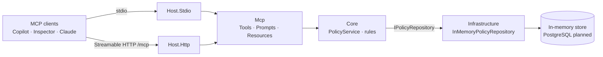

# BuildLogic45 Insurance MCP Server

[](https://dotnet.microsoft.com/)
[](https://github.com/modelcontextprotocol/csharp-sdk)
[](https://modelcontextprotocol.io/specification)

A [Model Context Protocol (MCP)](https://modelcontextprotocol.io) server for the insurance domain, built with .NET 10 and the official MCP C# SDK. It lets AI assistants such as GitHub Copilot, Claude, or any MCP client manage insurance policies through tools, prompts and resources.

The server runs on an **in-memory store seeded with sample policies** (e.g. `POL-2025-000101`), so no database is needed. Storage sits behind `IPolicyRepository`, ready to be replaced with PostgreSQL.

## Features

| Type | Name | Purpose |
|---|---|---|
| **Tools** | `search_policies` | Search by text, type, status and effective-date range (paged) |
| | `get_policy` | Get a policy by GUID or policy number |
| | `create_policy` | Create a policy (the policy number is generated) |
| | `update_policy` | Update only the fields you provide |
| | `delete_policy` | Delete a policy |
| **Resources** | `insurance://policies/{policyIdOrNumber}` | One policy as JSON |
| | `insurance://reference/policy-types`, `policy-statuses`, `policy-rules` | Reference data and validation rules |
| **Prompts** | `summarize_policy` | Plain-language or agent summary of a policy |
| | `review_customer_portfolio` | Coverage review of all of a customer's policies |
| | `draft_renewal_notice` | Renewal reminder email for a policy |
| | `new_policy_intake` | Guided conversation that ends in `create_policy` |

Validation failures and unknown policies are returned as readable MCP errors, so the model can correct itself.

## Architecture



- **Core** holds the domain model, business rules and the `IPolicyRepository` contract. It has no MCP or storage dependencies.
- **Infrastructure** implements the repository. `Persistence:Provider` selects the implementation, so adding PostgreSQL needs no changes elsewhere.
- **Mcp** is a thin adapter: it maps MCP requests to Core and domain errors to MCP errors.
- **Hosts** only choose the transport. Both call `WithInsuranceCapabilities()`, so stdio and HTTP behave identically.

## Project structure

```text
src/
  BuildLogic45.Insurance.Core/            # Domain model, business rules, IPolicyRepository
  BuildLogic45.Insurance.Infrastructure/  # In-memory repository + sample data
  BuildLogic45.Insurance.Mcp/             # MCP tools, prompts and resources
  BuildLogic45.Insurance.Host.Stdio/      # stdio host
  BuildLogic45.Insurance.Host.Http/       # Streamable HTTP host (/mcp, /health)
tests/
  BuildLogic45.Insurance.Core.Tests/              # Unit tests
  BuildLogic45.Insurance.Mcp.IntegrationTests/    # End-to-end tests with a real MCP client
.vscode/                                  # mcp.json (Copilot), launch.json (F5 debugging)
```

## Prerequisites

- [.NET SDK 10](https://dotnet.microsoft.com/download/dotnet/10.0)
- [Node.js 22.19+](https://nodejs.org/), only for the MCP Inspector
- [VS Code](https://code.visualstudio.com/) with [GitHub Copilot](https://marketplace.visualstudio.com/items?itemName=GitHub.copilot-chat) and [C# Dev Kit](https://marketplace.visualstudio.com/items?itemName=ms-dotnettools.csdevkit), optional

## Getting started

```bash
git clone https://github.com/<your-account>/<your-repo>.git
cd <your-repo>
dotnet build
dotnet test
```

## Running the server

**stdio:** usually launched by an MCP client, but you can start it manually:

```bash
dotnet run --project src/BuildLogic45.Insurance.Host.Stdio
```

**HTTP:** MCP endpoint at `http://localhost:5088/mcp`, health check at `http://localhost:5088/health`:

```bash
dotnet run --project src/BuildLogic45.Insurance.Host.Http
```

Configuration (`appsettings.json` or environment variables):

| Key | Default | Description |
|---|---|---|
| `Persistence:Provider` | `InMemory` | Storage backend |
| `Persistence:SeedSampleData` | `true` | Load sample policies at startup |
| `Logging:File:Path` | `<app dir>/logs/insurance-stdio-.log` | stdio log file (rolls daily) |

## Testing locally

### GitHub Copilot (VS Code)

[`.vscode/mcp.json`](.vscode/mcp.json) defines both servers. **Enable only one at a time**: they expose the same tool names, so Copilot may otherwise call the wrong one. The file ships with HTTP enabled and stdio commented out.

**HTTP**
1. Start the server: `dotnet run --project src/BuildLogic45.Insurance.Host.Http`, or use F5 (see below).
2. In `.vscode/mcp.json`, click **Start** above `insurance-http`.

**stdio**
1. In `.vscode/mcp.json`, uncomment `insurance-stdio` and comment out `insurance-http`.
2. Run **Developer: Reload Window**, then click **Start** above `insurance-stdio`. Copilot launches the server itself.

**Then, in Copilot Chat (Agent mode):**
- Ask, e.g. *"Search for all active auto policies"* or *"Get policy POL-2025-000102"*.
- Type `/` to use a prompt, e.g. `/mcp.insurance-http.summarize_policy`.
- Use **Add Context → MCP Resources** to attach a policy or the reference data.

### Debugging (F5)

[`.vscode/launch.json`](.vscode/launch.json) runs the HTTP host under the debugger. Open **Run and Debug**, select **Insurance HTTP MCP Server**, and choose **Run → Start Debugging**. On macOS you may need **fn + F5**. Breakpoints in tools, prompts or `PolicyService` are hit when Copilot or the Inspector calls the server.

### MCP Inspector (npx)

The [MCP Inspector](https://github.com/modelcontextprotocol/inspector) is a web UI for testing MCP servers.

```bash
# HTTP (server must be running)
npx @modelcontextprotocol/inspector --web --transport http --server-url http://localhost:5088/mcp

# stdio (the Inspector starts the server; run from the repo root)
npx @modelcontextprotocol/inspector --web --cwd "$PWD" dotnet run --project src/BuildLogic45.Insurance.Host.Stdio
```

Open the printed URL **including its token**, click **Connect**, then use the **Tools**, **Resources** and **Prompts** tabs. Stop the Inspector with **Ctrl+C**; closing the browser does not stop it.

For quick checks without a browser, use CLI mode:

```bash
npx @modelcontextprotocol/inspector --cli http://localhost:5088/mcp --method tools/list
npx @modelcontextprotocol/inspector --cli http://localhost:5088/mcp \
  --method tools/call --tool-name get_policy --tool-arg policyIdOrNumber=POL-2025-000102
npx @modelcontextprotocol/inspector --cli http://localhost:5088/mcp \
  --method prompts/get --prompt-name summarize_policy --prompt-args policyIdOrNumber=POL-2025-000101
```

### Sample inputs

These work against the sample data, in the Inspector forms, the CLI or as Copilot requests.

**Tools**

| Tool | Arguments | Expected result |
|---|---|---|
| `search_policies` | `{ "type": "Auto", "status": "Active" }` | 2 policies |
| `search_policies` | `{ "query": "sharma" }` | 2 policies for Aarav Sharma |
| `get_policy` | `{ "policyIdOrNumber": "POL-2025-000102" }` | Emily Johnson's home policy |
| `get_policy` | `{ "policyIdOrNumber": "00000000-0000-0000-0000-000000000001" }` | Same lookup by GUID |
| `create_policy` | `{ "policyHolderName": "Jane Doe", "policyHolderEmail": "jane.doe@example.com", "type": "Home", "effectiveDate": "2026-11-01", "expirationDate": "2027-11-01", "premium": 1500, "coverageAmount": 300000, "deductible": 1000 }` | New `Draft` policy with a generated number |
| `update_policy` | `{ "policyIdOrNumber": "POL-2026-000108", "status": "Active", "premium": 3800 }` | Only status and premium change |
| `delete_policy` | `{ "policyIdOrNumber": "POL-2025-000105" }` | Confirmation message |
| `get_policy` | `{ "policyIdOrNumber": "POL-0000" }` | Error: *Policy 'POL-0000' was not found.* |
| `create_policy` | Same as above, with `"policyHolderEmail": "not-an-email"` | Validation error |

**Resources**

| URI | Returns |
|---|---|
| `insurance://policies/POL-2025-000101` | Aarav Sharma's auto policy (JSON) |
| `insurance://reference/policy-types` | The five policy types with descriptions |
| `insurance://reference/policy-statuses` | The five statuses with descriptions |
| `insurance://reference/policy-rules` | Validation rules (Markdown) |

**Prompts**

| Prompt | Arguments |
|---|---|
| `summarize_policy` | `policyIdOrNumber` = `POL-2025-000101`, `audience` = `customer` or `agent` |
| `review_customer_portfolio` | `customer` = `Aarav Sharma` (two policies, one still in draft) |
| `draft_renewal_notice` | `policyIdOrNumber` = `POL-2025-000102` |
| `new_policy_intake` | `policyType` = `Home` (or leave it empty) |

**Copilot Chat requests**

- *"Show me all lapsed or expired policies"*
- *"Create a one-year auto policy for John Smith, john.smith@example.com, starting next Monday, premium 900, coverage 40000"*
- *"Raise the deductible on POL-2025-000109 to 1500"*
- *"Which of Aarav Sharma's policies need attention?"*

## Troubleshooting

| Problem | Fix |
|---|---|
| No logs in VS Code's MCP Output channel (stdio) | Copilot discards server stderr. Use `tail -f logs/insurance-stdio-*.log` |
| Breakpoints not hit | Copilot is calling the other server. Enable only one in `.vscode/mcp.json` and reload the window |
| Port 5088 already in use | Stop the other instance: `lsof -nP -iTCP:5088 -sTCP:LISTEN` |
| Created data disappears | Data is in memory: each server process has its own copy, reset on restart |
| Inspector says unauthorized | Open the URL printed in the terminal, including the token |

## Roadmap

- [x] Policy tools, prompts and resources with in-memory data
- [ ] Claims management
- [ ] PostgreSQL persistence
- [ ] Authentication for the HTTP transport

## License

No license has been chosen yet. Until a `LICENSE` file is added, all rights are reserved by the author.
